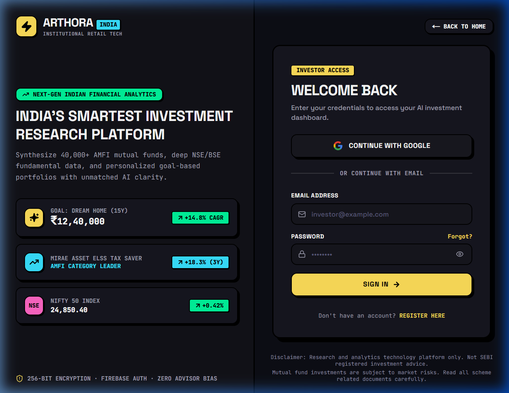

<div align="center">

# ⚡ ARTHORA (अर्थोरा)

### *Institutional-Grade AI Investment Research & Portfolio Architecture for India*

[](https://arthora.vercel.app)
[](https://arthora-api.onrender.com/api/v1/health)
[](https://nextjs.org)
[](https://www.typescriptlang.org)
[](https://nodejs.org)
[](https://www.mongodb.com)
[](https://upstash.com)
[](https://aistudio.google.com)
[](https://vitest.dev)
[](LICENSE)

<br/>

[🌐 **Open Live Web App**](https://arthora.vercel.app) • [🩺 **API Health Check**](https://arthora-api.onrender.com/api/v1/health) • [🚀 **Deployment Guide**](docs/DEPLOYMENT.md) • [🎨 **Design System**](docs/DESIGN_SYSTEM.md) • [🛡️ **Security Policy**](SECURITY.md)

<br/>

<a href="https://arthora.vercel.app">
  
</a>

</div>

---

## 💡 What is Arthora?

**Arthora** empowers India's 14+ crore retail investors with the same quantitative firepower used by top hedge funds and institutional desks. 

By unifying **40,000+ AMFI mutual fund schemes**, real-time **NSE & BSE equity market feeds**, **Google Gemini 1.5 Flash AI**, and deterministic mathematical financial engines, Arthora generates personalized goal-based portfolios, calculates 14 trailing risk-adjusted ratios, and provides institutional PDF research dossiers — completely free for retail users.

```
       ┌────────────────────────┐              ┌────────────────────────┐
       │   AMFI Direct Feeds    │              │   NSE / BSE Real-Time  │
       │ (40,000+ Mutual Funds) │              │ (Quotes & Candlesticks)│
       └───────────┬────────────┘              └───────────┬────────────┘
                   │                                       │
                   └───────────────────┬───────────────────┘
                                       ▼
                       ┌───────────────────────────────┐
                       │   Deterministic Math Engine   │
                       │ Sharpe · Sortino · Alpha/Beta │
                       │   CAGR · Rolling Drawdowns    │
                       └───────────────┬───────────────┘
                                       │
                   ┌───────────────────┴───────────────────┐
                   ▼                                       ▼
       ┌───────────────────────┐               ┌───────────────────────┐
       │ Gemini 1.5 Flash AI   │               │ Neo-Brutalist Client  │
       │ Goal Portfolio Engine │               │ Fluid Particle Canvas │
       └───────────────────────┘               └───────────────────────┘
```

---

## ✨ Key Capabilities

| Capability | What It Does | Technology |
| :--- | :--- | :--- |
| **🤖 AI Portfolio Architect** | Generates goal-oriented asset allocations with Monte Carlo simulations and zero LLM hallucination safeguards. | Gemini 1.5 Flash + Custom Heuristic Engine |
| **📊 40,000+ Mutual Fund Screener** | Real-time AMFI NAV analytics, category rankings, and rolling return risk ratios (Sharpe, Sortino, Beta). | AMFI Scraper + MongoDB Time-Series |
| **📈 Equity Fundamentals & Technics** | Live candlestick historical charts, moving averages (20/50/200 SMA), RSI, MACD, and shareholding patterns. | NSE/BSE Market Data Engine |
| **⚡ Neo-Brutalist High-Contrast UX** | Built with cyber fluid particle background physics, high-contrast borders, tactile drop shadows, and dark mode. | Next.js 14 + Tailwind CSS + HTML5 Canvas |
| **🛡️ Institutional Security Guard** | Rate limiting, Argon2id password encryption, Redis sliding windows, and dual JWT rotation. | Upstash Redis + Argon2id + Helmet |
| **📱 Native Mobile Ecosystem** | Seamless iOS and Android experience sharing the same backend and design tokens. | Flutter 3.29 + Riverpod State Management |

<div align="center">
  
</div>

---

## 🗂️ Clean Monorepo Architecture

The repository is organized as a high-performance, modular **pnpm workspace**:

```text
arthora/
├── apps/
│   ├── web/                   # Next.js 14 Client (App Router, Tailwind CSS, Neo-Brutalism, Static Export)
│   │   ├── src/app/           # Routes: Landing (/), Research (/research), AI (/ai), Watchlist, Settings
│   │   ├── src/components/    # Modular UI components, charts, and fluid particle canvas
│   │   └── src/store/         # Persistent Zustand global stores (Auth, Portfolio, Watchlist)
│   │
│   └── api/                   # Express.js 4 REST API Gateway & BullMQ Workers
│       ├── src/main.ts        # Primary API server entry point (port 4000)
│       ├── src/routes/        # REST routes: /auth, /funds, /stocks, /portfolios, /charts, /reports
│       └── src/lib/           # Calculations, Mongoose models, external scrapers, security middleware
│
├── packages/
│   ├── shared/                # Universal TypeScript models, Zod validation schemas, Indian currency formatters
│   └── sdk/                   # Isomorphic API client library for frontend, mobile, and third-party consumers
│
├── arthora_mobile/            # Cross-platform Flutter 3.29+ mobile application (iOS & Android)
├── docs/                      # Architectural Decision Records (ADRs), PRD, Compliance, and Deployment docs
├── scripts/                   # Automated pre-commit verification gates (verify-all.ps1, verify-all.sh)
├── vercel.json                # Vercel Monorepo deployment specification
└── render.yaml                # Render Infrastructure-as-Code Blueprint
```

---

## 🚀 Quickstart & Local Setup

### Prerequisites
- **Node.js**: `v20.x` or later
- **pnpm**: `v9.x` or `v10.x` (`npm install -g pnpm`)

### 1. Clone & Install
```bash
git clone https://github.com/syedzahidsaleem/arthora.git
cd arthora
pnpm install
```

### 2. Configure Environment
```bash
# Backend configuration
cp apps/api/.env.example apps/api/.env

# Frontend configuration
cp apps/web/.env.example apps/web/.env.local
```

### 3. Build Shared Packages & Run
```bash
# 1. Compile shared TypeScript contracts
pnpm --filter @arthora/shared build

# 2. Start the Backend API (runs on http://localhost:4000)
pnpm --filter @arthora/api dev

# 3. Start the Web Client (runs on http://localhost:3000)
pnpm --filter @arthora/web dev
```

---

## 🧪 Automated Quality Gates

Arthora enforces automated test coverage and type safety across all monorepo workspaces:

```bash
# Run all automated checks in one command (Cross-Platform)
# On Windows PowerShell:
powershell -ExecutionPolicy Bypass -File ./scripts/verify-all.ps1

# On macOS / Linux:
./scripts/verify-all.sh
```

| Check | Workspace | Result |
| :--- | :--- | :--- |
| **Shared Contracts** | `@arthora/shared` | 10 passed (100%) |
| **Web Client Tests** | `@arthora/web` | 4 passed (100%) |
| **API & Worker Tests** | `@arthora/api` | 92 passed (100%) |
| **Static Build Gate** | `@arthora/web` | All 13 routes pre-rendered to `apps/web/out` |
| **Total Test Count** | **Monorepo** | **106 passed (100%)** |

---

## 🌐 Production Deployments

- **Web Frontend**: [https://arthora.vercel.app](https://arthora.vercel.app) *(Vercel Global Edge CDN)*
- **API Gateway**: [https://arthora-api.onrender.com](https://arthora-api.onrender.com) *(Render Container)*
- **Health Check**: [https://arthora-api.onrender.com/api/v1/health](https://arthora-api.onrender.com/api/v1/health)

For full deployment instructions, see the [Production Deployment Guide](docs/DEPLOYMENT.md).

---

## ⚖️ Compliance & Disclaimer

> [!IMPORTANT]
> **Arthora is a financial technology and research platform, NOT a SEBI-registered Investment Adviser (RIA) or Research Analyst (RA).**  
> All financial calculations, risk metrics, and AI portfolio simulations are provided strictly for educational and analytical purposes. Direct investments in securities and mutual funds carry market risk.

---

## 📄 License

This repository is open-source under the [MIT License](LICENSE).

<div align="center">
  <sub>Crafted with passion for Indian retail investors • Maintained by <a href="https://github.com/syedzahidsaleem">Syed Zahid Saleem</a></sub>
</div>
