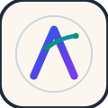
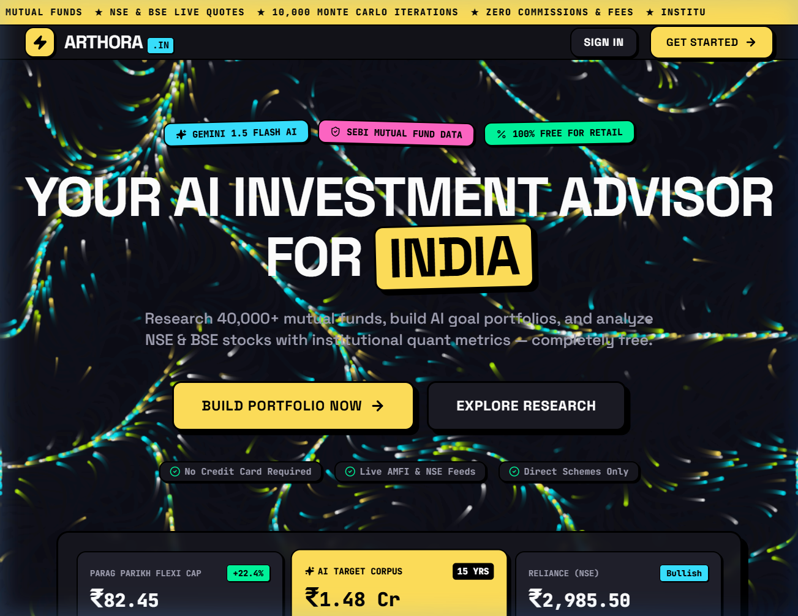
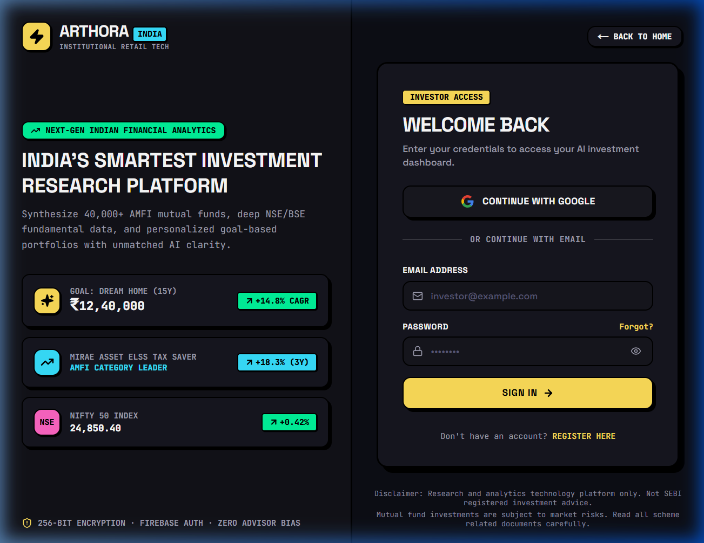

<div align="center">

  <picture>
    <source media="(prefers-color-scheme: dark)" srcset=".github/assets/logo-dark.svg">
    
  </picture>

  <h1>Arthora</h1>

  <p><em>Institutional-Grade AI Investment Research & Portfolio Architecture for India</em></p>

  <a href="LICENSE"></a>
  <a href="https://github.com/syedzahidsaleem/arthora/stargazers"></a>
  <a href="https://github.com/syedzahidsaleem/arthora/network/members"></a>
  <a href="https://github.com/syedzahidsaleem/arthora/issues"></a>
  <a href="https://github.com/syedzahidsaleem/arthora/commits/main"></a>
  <a href="https://arthora.vercel.app"></a>

  <br/>

  
  
  
  
  
  

  <br/><br/>

  <a href="https://arthora.vercel.app"><b>Explore Live App</b></a> •
  <a href="https://arthora-api.onrender.com/api/v1/health"><b>API Gateway Health</b></a> •
  <a href="https://github.com/syedzahidsaleem/arthora/issues"><b>Report Bug</b></a> •
  <a href="https://github.com/syedzahidsaleem/arthora/issues"><b>Request Feature</b></a>

</div>

---

<div id="demo" align="center">
  <a href="https://arthora.vercel.app">
    
  </a>
  <p><em>Arthora's tactile Neubrutalist terminal unifying live AMFI fund analytics, goal allocations, and quantitative risk metrics.</em></p>
</div>

---

## About The Project

India's 14+ crore retail investors navigate fragmented mutual fund portals and opaque marketing claims without access to the quantitative risk models used by institutional desks.

**Arthora** bridges this gap by unifying **40,000+ AMFI mutual fund schemes** and live **NSE equity feeds** into a unified intelligence terminal. It couples mathematical risk modeling (Sharpe, Sortino, max drawdown) with Google Gemini 1.5 Flash AI to generate verified, deterministic goal-based portfolios.

Built for retail investors, financial advisors, and quantitative researchers who demand institutional rigor with consumer simplicity.

---

## Features

- **AI Portfolio Architect** — Generate personalized asset allocations aligned with your exact risk appetite, timeline, and goals using Modern Portfolio Theory with zero-hallucination safeguards.
- **40,000+ AMFI Fund Screener** — Filter and rank Indian mutual funds by historical rolling returns (1Y/3Y/5Y), category benchmarks, AUM, and portfolio sector weightings.
- **Institutional Risk Engine** — Compute high-precision financial metrics on demand including CAGR, annualized volatility, Sharpe ratio, Sortino ratio, beta, and maximum historical drawdown.
- **NSE Equity Analytics** — Inspect interactive candlestick charts, moving averages (20/50/200 SMA), key valuation ratios, and quarterly institutional shareholding patterns.
- **Tactile Neubrutalist UX** — Engineered with bold typography, high-contrast borders, solid drop shadows, and accessible WCAG AA keyboard navigation.
- **Autonomous Resilience** — High-availability architecture powered by distributed Upstash Redis TLS caching, automated keep-alive pingers, and global Vercel edge deployment.

---

## Built With

<div align="center">

<a href="https://www.typescriptlang.org"></a>
<a href="https://nextjs.org"></a>
<a href="https://nodejs.org"></a>
<a href="https://expressjs.com"></a>
<a href="https://tailwindcss.com"></a>
<a href="https://www.mongodb.com"></a>
<a href="https://upstash.com"></a>
<a href="https://aistudio.google.com"></a>
<a href="https://vitest.dev"></a>
<a href="https://vercel.com"></a>

</div>

---

## Getting Started

### Prerequisites

- **Node.js**: `>= 20.0.0`
- **pnpm**: `>= 9.0.0` (`npm install -g pnpm`)

### 1. Clone the repository

```bash
git clone https://github.com/syedzahidsaleem/arthora.git
cd arthora
```

### 2. Install dependencies

```bash
pnpm install
```

### 3. Environment setup

Create local environment files following the templates provided in `.env.example`:

```bash
# Backend environment
cp apps/api/.env.example apps/api/.env

# Frontend environment
cp apps/web/.env.example apps/web/.env.local
```

### 4. Build shared packages and launch development servers

```bash
# Compile shared TypeScript contracts
pnpm --filter @arthora/shared build

# Start Backend API (http://localhost:4000)
pnpm --filter @arthora/api dev

# Start Web Frontend (http://localhost:3000)
pnpm --filter @arthora/web dev
```

---

## Usage

Query mutual fund metrics or generate a goal-based portfolio using the Arthora API:

```bash
# Fetch real-time quantitative metrics for Parag Parikh Flexi Cap Fund (122639)
curl -s https://arthora-api.onrender.com/api/v1/funds/122639/metrics | jq .
```

```json
{
  "schemeCode": 122639,
  "cagr1Y": 24.62,
  "cagr3Y": 21.34,
  "cagr5Y": 23.51,
  "sharpeRatio": 1.84,
  "sortinoRatio": 2.45,
  "maxDrawdown": -8.12,
  "beta": 0.76
}
```

---

## Screenshots

<div align="center">
  <table>
    <tr>
      <td width="50%">
        
        <p align="center"><b>Institutional Research & Fund Analytics Hub</b></p>
      </td>
      <td width="50%">
        
        <p align="center"><b>Investor Authentication & Security Portal</b></p>
      </td>
    </tr>
  </table>
</div>

---

## Repository Structure

```text
arthora/
├── apps/
│   ├── web/                   # Next.js 14 App Router client (Static Export, Tailwind CSS, Neo-Brutalism)
│   └── api/                   # Express.js REST API gateway, Mongoose models, and BullMQ worker queue
├── packages/
│   ├── shared/                # Universal TypeScript models, Zod validation schemas, Indian formatters
│   └── sdk/                   # Isomorphic API client library for frontend, mobile, and third-party consumers
├── arthora_mobile/            # Cross-platform Flutter 3.29+ mobile application (iOS & Android)
├── docs/                      # Technical documentation, specifications, and architecture guides
│   ├── architecture/          # System design, database schemas, and data flow specifications
│   ├── specs/                 # Product requirements (PRD), API contracts, and design tokens
│   ├── guides/                # Deployment, verification, contributing, and security policies
│   └── audits/                # Forensic architecture and UI/E2E test verification reports
├── scripts/                   # Automated monorepo quality gate runners (verify-all.ps1, verify-all.sh)
└── .github/                   # CI/CD workflows, release packaging, and brand visual assets
```

---

## Roadmap

- [x] Full AMFI 40,000+ mutual fund screener & NAV ingestion
- [x] Gemini 1.5 Flash portfolio generator with deterministic fallback
- [x] Neubrutalist responsive interface across all dashboard routes
- [x] Zero-warning production build & 106 automated Vitest gates
- [ ] Direct broker integration (Zerodha Kite & Upstox OAuth)
- [ ] Real-time SIP auto-rebalancing notifications via Web Push
- [ ] Exportable SEBI-compliant institutional PDF research dossiers

Follow progress or suggest capabilities on the [GitHub Issues](https://github.com/syedzahidsaleem/arthora/issues) board.

---

## Contributing

Contributions make the open-source community an inspiring place to learn and build:

1. **Fork** the repository
2. **Create** your feature branch (`git checkout -b feat/quantum-analytics`)
3. **Commit** your changes (`git commit -m "feat: add quantum risk analytics"`)
4. **Push** to the branch (`git push origin feat/quantum-analytics`)
5. **Open** a Pull Request against `main`

Please read our [Contribution Guidelines](.github/CONTRIBUTING.md), adhere to our [Code of Conduct](.github/CODE_OF_CONDUCT.md), and review our [Security Policy](.github/SECURITY.md).

If you find Arthora helpful, please consider giving it a ⭐️ on GitHub!

---

## License

Distributed under the **MIT License**. See [`LICENSE`](LICENSE) for details.

---

<div align="center">
  <sub>Built with ❤️ by <a href="https://github.com/syedzahidsaleem">Syed Zahid Saleem</a> • Jain University, Bangalore</sub>
</div>