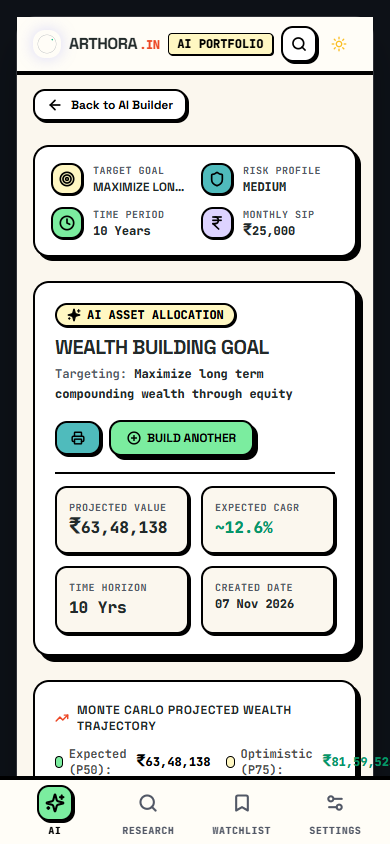

<p align="center">
  <a href="https://arthora.vercel.app">
    
  </a>
</p>

<h1 align="center">Arthora</h1>

<p align="center">
  <strong>Autonomous Quantitative Research & Multi-Asset Intelligence for Indian Retail Investors.</strong><br>
  Institutional quant metrics, 10,000 Monte Carlo wealth simulations, and direct mutual fund indexing powered by Google Gemini.
</p>

<p align="center">
  <a href="https://arthora.vercel.app"></a>
  <a href="https://github.com/syedzahidsaleem/arthora/actions/workflows/ci.yml"></a>
  <a href="https://ai.google.dev"></a>
  <a href="LICENSE"></a>
  
</p>

<p align="center">
  <a href="https://arthora.vercel.app"><strong>Explore Live App</strong></a> •
  <a href="https://arthora-api.onrender.com/api/v1/health"><strong>API Health</strong></a> •
  <a href="#how-it-works"><strong>Architecture</strong></a> •
  <a href="#product-interface"><strong>Interface Gallery</strong></a> •
  <a href="docs/"><strong>API reference and deployment guide</strong></a>
</p>

---

##  The Problem

Indian retail investing has expanded past [16+ crore demat accounts](https://www.sebi.gov.in), yet individual investors face structural disadvantages against institutional players:

| <br>**Commission Opacity** | <br>**Risk Fragmentation** | <br>**Generic Investment Advice** |
| :--- | :--- | :--- |
| Regular mutual fund plans quietly extract [1.0%–1.5% annually](https://www.amfiindia.com) in distributor trail commissions, costing long-term investors lakhs in compounded wealth. | Retail portals emphasize trailing returns without publishing downside volatility, Sharpe ratios, or historical drawdown percentiles against Nifty 50. | Traditional investment services use static risk questionnaires to push cookie-cutter portfolios rather than personalized stochastic projections. |

---

##  The Solution

Arthora delivers hedge-fund-grade quantitative intelligence and autonomous portfolio creation directly to Indian retail investors:

- **Direct-Growth Prioritization:** Automatically ingests and indexes **40,000+ AMFI mutual fund schemes**, prioritizing Direct-Growth plans to eliminate distributor commissions.
- **Institutional Quant Engine:** Computes rolling returns, downside risk, Sharpe ratios, and executes **10,000-iteration Monte Carlo simulations** to generate P10, P50, and P75 wealth trajectory cones.
- **AI Portfolio Builder:** Portfolios are generated by **Google Gemini with built-in validation and fallback**, evaluating investor goals, time horizons, and risk tolerance into personalized portfolios with written investment theses.

---

<a id="how-it-works"></a>
##  How It Works

<p align="center">
  <picture>
    <source media="(prefers-color-scheme: dark)" srcset=".github/assets/architecture-dark.svg">
    <source media="(prefers-color-scheme: light)" srcset=".github/assets/architecture-light.svg">
    
  </picture>
</p>

1. **Ingestion & Sync:** Scheduled background workers synchronize daily NAV updates from AMFI feeds and live quotes (may be delayed) for NSE Equities into MongoDB Atlas.
2. **Quantitative Analysis:** The math engine computes risk metrics (Sharpe ratio, Alpha, Beta, Max Drawdown) and runs 10,000 stochastic Monte Carlo simulation paths.
3. **AI Synthesis & Verification:** Portfolios are generated by Google Gemini with an automatic deterministic fallback if the model is unavailable; every suggested fund is verified against AMFI data before it is shown, evaluating financial goals against filtered direct schemes to synthesize asset allocations with investment rationales.
4. **Client Delivery:** Interactive responsive web terminal (Next.js 14) and mobile client (Flutter in `apps/mobile`) deliver charts, allocations, and headless PDF reports via BullMQ workers.

---

##  Tech Stack

| Layer | Technologies | Role & Implementation |
| :--- | :--- | :--- |
| **Frontend** |  | Next.js 14 (App Router), React 18, Tailwind CSS, Recharts, Lucide, Neo-Brutalist UI |
| **Backend** |  | Node.js, Express, TypeScript, Zod validation, Argon2id auth, JWT refresh rotation |
| **AI & Quant** |  | Google Gemini with built-in validation and fallback, 10,000 Monte Carlo Engine |
| **Data & Cache** |  | MongoDB Atlas (40K+ schemes), Redis (BullMQ queue management, rate limiting, caching) |
| **Workers** |  | BullMQ background workers, Puppeteer (Headless institutional PDF generation) |
| **Mobile** |  | Cross-platform client in `apps/mobile` (platform shells initialized via `flutter create`) |
| **DevOps** |  | Vercel (Web hosting), Render (API & Workers), Docker, GitHub Actions CI |

---

<a id="product-interface"></a>
##  Product Interface

<p align="center">
  <a href=".github/assets/screenshots/01-landing-hero.png">
    
  </a>
  <br>
  <sub><strong>Landing Hero & Neo-Brutalist Value Proposition</strong> — Educational direct-fund screening and stochastic wealth projections.</sub>
</p>

<table width="100%">
  <tr>
    <td valign="top" width="50%" align="center">
      <a href=".github/assets/screenshots/02-research-hub.png">
        
      </a>
      <br>
      <strong>Investment Research Hub</strong>
      <br>
      <sub>40,000+ AMFI Mutual Funds & Live NSE Quotes</sub>
    </td>
    <td valign="top" width="50%" align="center">
      <a href=".github/assets/screenshots/06-ai-portfolio-result.png">
        
      </a>
      <br>
      <strong>Monte Carlo Wealth Trajectory</strong>
      <br>
      <sub>10Y Stochastic Cones (P50/P75) & Curated Weights</sub>
    </td>
  </tr>
  <tr>
    <td valign="top" width="50%" align="center">
      <a href=".github/assets/screenshots/03-fund-detail.png">
        
      </a>
      <br>
      <strong>Fund Research & Compound SIP Simulator</strong>
      <br>
      <sub>Direct Growth NAVs, Quant Metrics & SIP Projections</sub>
    </td>
    <td valign="top" width="50%" align="center">
      <a href=".github/assets/screenshots/05-ai-goal-form.png">
        
      </a>
      <br>
      <strong>AI Goal Builder Form</strong>
      <br>
      <sub>Natural Language Goal Input & Risk Sliders</sub>
    </td>
  </tr>
</table>

<details>
<summary><b>View Additional Product Screens (Stock Signals, Watchlist, Mobile Viewport)</b></summary>
<br>

<table width="100%">
  <tr>
    <td valign="top" width="50%" align="center">
      <a href=".github/assets/screenshots/04-stock-detail.png">
        
      </a>
      <br>
      <strong>Technical Momentum & Trend Signals</strong>
      <br>
      <sub>RSI, MACD & 50/200 SMA Bull/Bear Cross Indicators</sub>
    </td>
    <td valign="top" width="50%" align="center">
      <a href=".github/assets/screenshots/07-watchlist.png">
        
      </a>
      <br>
      <strong>Multi-Asset Investment Watchlist</strong>
      <br>
      <sub>Side-by-Side Fund & Stock Tracking</sub>
    </td>
  </tr>
</table>

<p align="center">
  <strong>Responsive web app at 390px</strong>
</p>
<p align="center">
  <a href=".github/assets/screenshots/08-mobile-dashboard.png">
    
  </a>
  &nbsp;&nbsp;&nbsp;&nbsp;
  <a href=".github/assets/screenshots/09-mobile-portfolio.png">
    
  </a>
</p>

</details>

---

##  Roadmap

- [x] **AMFI Daily NAV Sync:** Automated indexing pipeline across 40,000+ Indian mutual fund schemes.
- [x] **Institutional Quant Engine:** Rolling returns, drawdown distributions, and Sharpe ratio calculators.
- [x] **AI Portfolio Builder:** Portfolios generated by Google Gemini with built-in validation and fallback.
- [x] **Monte Carlo Simulation:** 10,000 stochastic iteration engine generating P10, P50, and P75 probability cones.
- [x] **Async PDF Generation:** Headless Puppeteer and BullMQ worker compiling institutional research tearsheets.
- [x] **Responsive Web Terminal:** Accessible Neo-Brutalist dashboard with keyboard-accessible, dark-mode UI.
- [ ] **Mobile Store Builds:** Pre-configured iOS and Android builds (`apps/mobile` platform shells).

---

<details>
<summary><b>Monorepo Architecture & Verified Local Quickstart</b></summary>

### Repository Layout

```
arthora/
├── apps/
│   ├── api/            # Express, TypeScript REST API, Mongo/Redis models, Gemini engine
│   ├── web/            # Next.js 14 App Router terminal, Recharts, Neo-Brutalist UI
│   └── mobile/         # Flutter cross-platform client (platform shells via flutter create)
├── packages/
│   ├── shared/         # Zod contracts, shared domain models, INR currency formatters
│   └── sdk/            # TypeScript API client library for internal & external integration
└── docs/               # Architecture contracts, API specifications, deployment guides
```

### Verified Local Quickstart

Prerequisites: **Node.js >= 20**, **pnpm >= 10**, and **Docker** (or hosted MongoDB & Redis).

```bash
# 1. Clone repository
git clone https://github.com/syedzahidsaleem/arthora.git
cd arthora

# 2. Start local datastores (or connect to hosted MongoDB & Redis)
docker compose up -d mongodb redis

# 3. Configure local environment variables
cp apps/api/.env.example apps/api/.env
cp apps/web/.env.example apps/web/.env.local

# 4. Install workspace dependencies
pnpm install

# 5. Build shared type contracts
pnpm --filter @arthora/shared build

# 6. Start API and Web services concurrently
pnpm dev

# 7. Run full workspace verification (types, lint, tests, web export)
pnpm run verify
```

### Live API Verification Example

```bash
curl -s "https://arthora-api.onrender.com/api/v1/funds/118834"
```

```json
{
  "success": true,
  "data": {
    "schemeCode": 118834,
    "schemeName": "Mirae Asset Large & Midcap Fund - Direct Plan - Growth",
    "fundHouse": "Mirae Asset Mutual Fund",
    "category": "Equity Schemes - Large & Mid Cap Fund",
    "isin": "INF769K01BI1",
    "schemeType": "Open Ended Schemes",
    "latestNAV": 176.184,
    "latestNAVDate": "2026-11-05T00:00:00.000Z"
  },
  "timestamp": "2026-11-06T09:35:12.081Z"
}
```

</details>

---

> [!IMPORTANT]
> **SEBI Educational Notice:** Arthora is an educational analytics and quantitative modeling platform. It is not registered as an Investment Adviser (RIA) or Research Analyst (RA) with the Securities and Exchange Board of India (SEBI). All mathematical projections, Monte Carlo simulations, and AI-generated portfolios are for educational and analytical purposes only and do not constitute financial advice or investment recommendations.

### Acknowledgements

- [AMFI India](https://www.amfiindia.com) for official mutual fund NAV data feeds.
- [mfapi.in](https://www.mfapi.in) for historical mutual fund NAV API feeds.
- [Yahoo Finance](https://finance.yahoo.com) for live NSE equity quote feeds.
- [Google AI Studio](https://ai.google.dev) for Google Gemini API access.
- [Lucide Icons](https://lucide.dev) & [Skill Icons](https://skillicons.dev) for interface iconography.

<p align="center">
  <sub>Built by <a href="https://github.com/syedzahidsaleem">Syed Zahid Saleem</a> • Built with precision for India's next generation of informed investors.</sub>
</p>
