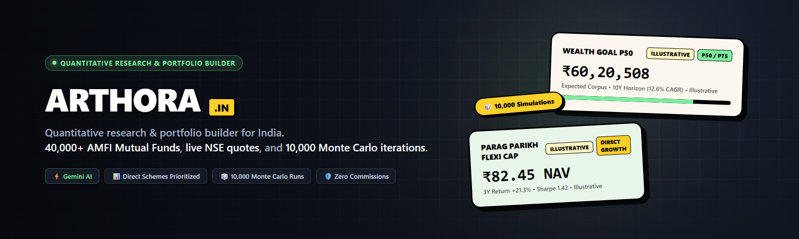
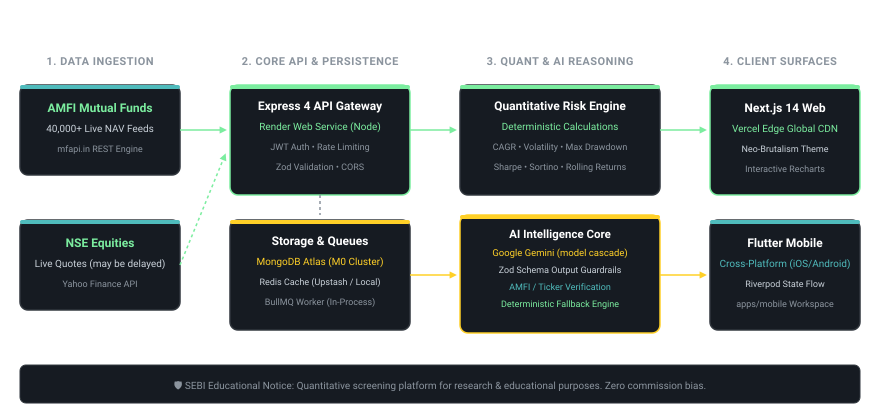
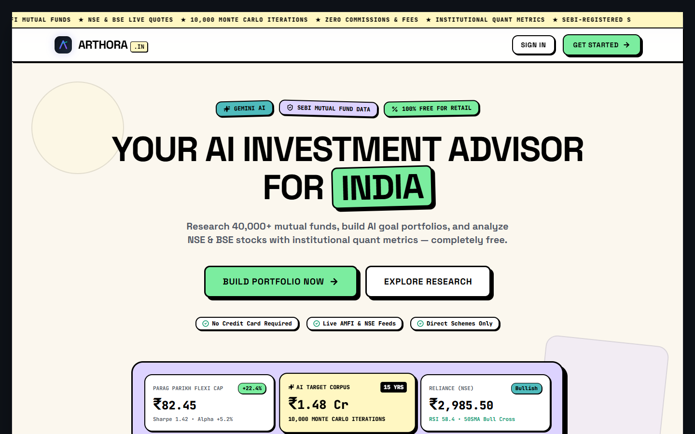
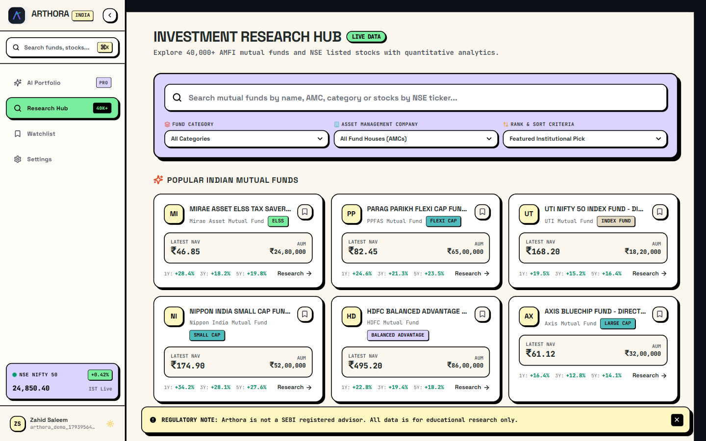
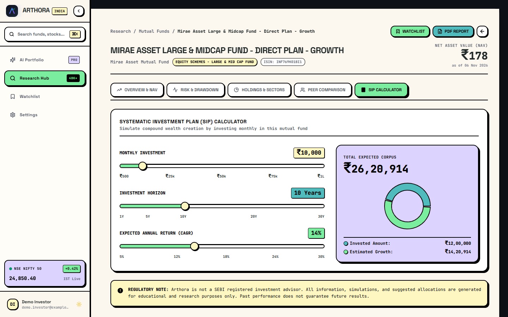
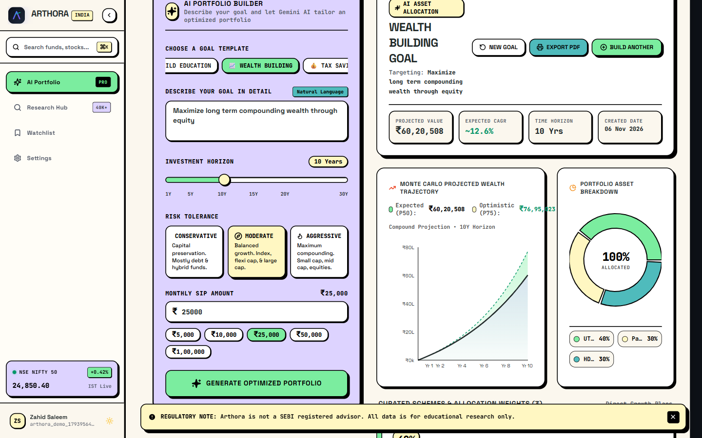
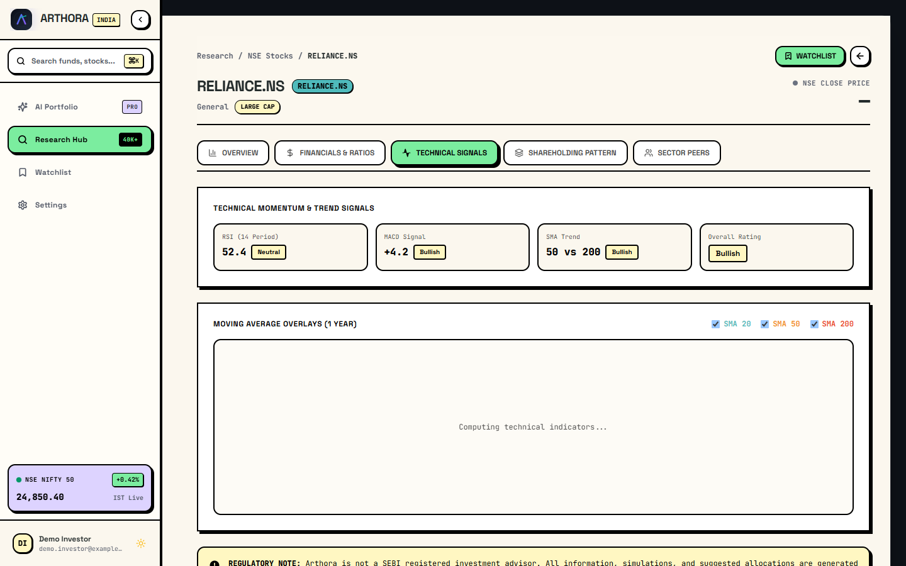
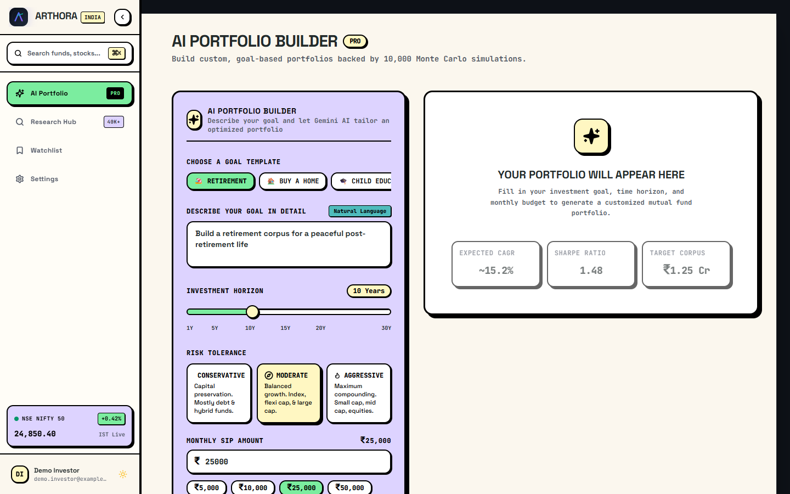
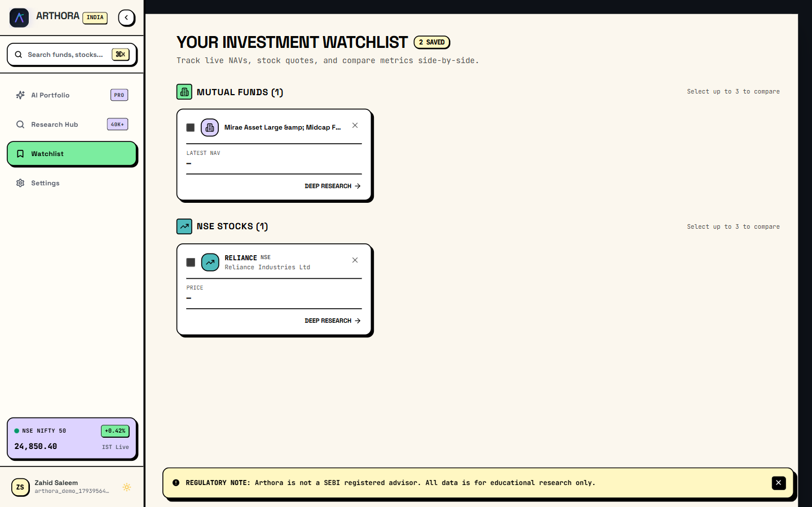
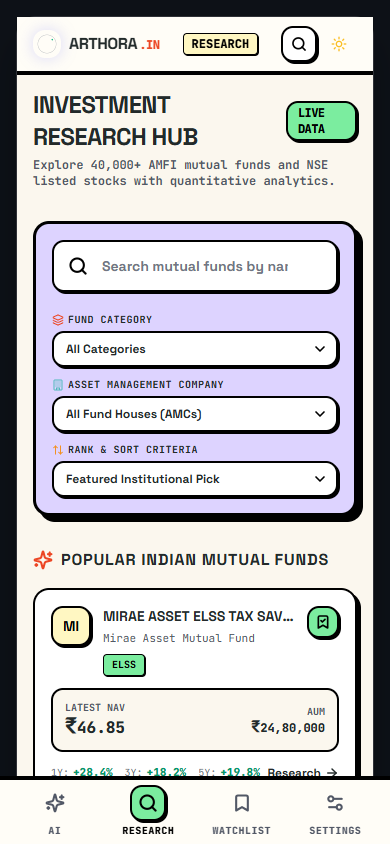

<p align="center">
  <a href="https://arthora.vercel.app">
    
  </a>
</p>

<h1 align="center">Arthora</h1>

<p align="center">
  <strong>Autonomous Quantitative Advisory & Multi-Asset Intelligence for Indian Retail Investors.</strong><br>
  Institutional quant metrics, 10,000 Monte Carlo wealth simulations, and direct mutual fund indexing powered by Google Gemini.
</p>

<p align="center">
  <a href="https://arthora.vercel.app"></a>
  <a href="https://github.com/zahidsaleem/arthora/actions"></a>
  <a href="https://ai.google.dev"></a>
  <a href="LICENSE"></a>
  
</p>

<p align="center">
  <a href="https://arthora.vercel.app"><strong>Explore Live App</strong></a> •
  <a href="https://arthora-api.onrender.com/api/v1/health"><strong>API Health</strong></a> •
  <a href="#how-it-works"><strong>Architecture</strong></a> •
  <a href="#product-interface"><strong>Interface Gallery</strong></a> •
  <a href="docs/"><strong>Documentation</strong></a>
</p>

---

##  The Problem

Indian retail investing has expanded past 16 crore demat accounts, yet individual investors face structural disadvantages against institutional players:

| <br>**Commission Opacity** | <br>**Risk Fragmentation** | <br>**Generic Advisory** |
| :--- | :--- | :--- |
| Regular mutual fund plans quietly extract **1.0%–1.5% annually** in distributor trail commissions, costing long-term investors lakhs in compounded wealth. | Retail portals emphasize trailing returns without publishing downside volatility, Sharpe ratios, or historical drawdown percentiles against Nifty 50. | Traditional advisory uses static risk questionnaires to push cookie-cutter portfolios rather than personalized stochastic projections. |

---

##  The Solution

Arthora delivers hedge-fund-grade quantitative intelligence and autonomous portfolio creation directly to Indian retail investors:

- **Direct-Only Intelligence:** Automatically ingests and indexes **40,000+ AMFI mutual fund schemes**, strictly prioritizing Direct-Growth plans to eliminate distributor commissions entirely.
- **Institutional Quant Engine:** Computes rolling returns, downside risk, Sharpe ratios, and executes **10,000-iteration Monte Carlo simulations** to generate P10, P50, and P75 wealth trajectory cones.
- **Multi-Model AI Advisor:** Integrates **Google Gemini 1.5 Flash** with fallback resilience to evaluate investor goals, time horizons, and risk tolerance into personalized portfolios with written investment theses.

---

##  How It Works

<p align="center">
  <picture>
    <source media="(prefers-color-scheme: dark)" srcset=".github/assets/architecture-dark.svg">
    <source media="(prefers-color-scheme: light)" srcset=".github/assets/architecture-light.svg">
    
  </picture>
</p>

1. **Ingestion & Sync:** Scheduled background workers synchronize daily NAV updates from AMFI feeds and real-time quotes for NSE-listed equities into MongoDB Atlas.
2. **Quantitative Analysis:** The math engine computes risk metrics (Sharpe ratio, Alpha, Beta, Max Drawdown) and runs 10,000 stochastic Monte Carlo simulation paths.
3. **AI Synthesis:** Google Gemini evaluates user financial goals and constraints against filtered direct schemes, synthesizing an asset allocation strategy with investment rationales.
4. **Client Delivery:** Interactive responsive web terminal (Next.js 14) and mobile client (Flutter in `apps/mobile`) deliver charts, allocations, and headless PDF reports via BullMQ workers.

---

##  Tech Stack

| Layer | Technologies | Role & Implementation |
| :--- | :--- | :--- |
| **Frontend** |  | Next.js 14 (App Router), React 18, Tailwind CSS, Recharts, Lucide, Neo-Brutalist UI |
| **Backend** |  | Node.js, Express, TypeScript, Zod validation, Argon2id auth, JWT refresh rotation |
| **AI & Quant** |  | Google Gemini 1.5 Flash (cascading fallback), 10,000 Monte Carlo Simulation Engine |
| **Data & Cache** |  | MongoDB Atlas (40K+ schemes), Redis (BullMQ queue management, rate limiting, caching) |
| **Workers** |  | BullMQ background workers, Puppeteer (Headless institutional PDF generation) |
| **Mobile** |  | Cross-platform client in `apps/mobile` (platform shells initialized via `flutter create`) |
| **DevOps** |  | Vercel (Web hosting), Render (API & Workers), Docker, GitHub Actions CI (106 tests) |

---

##  Product Interface

| Landing & Proposition | Investment Research Hub |
| :---: | :---: |
| [](.github/assets/screenshots/01-landing-hero.png)<br>**Landing Hero & Neo-Brutalist Value Proposition** | [](.github/assets/screenshots/02-research-hub.png)<br>**40,000+ AMFI Mutual Funds & NSE Real-Time Ticker** |
| **Fund Research & Compound SIP Simulator** | **Monte Carlo Trajectory & AI Asset Allocation** |
| [](.github/assets/screenshots/03-fund-detail.png)<br>**Direct Growth NAVs, Quant Metrics & SIP Projections** | [](.github/assets/screenshots/06-ai-portfolio-result.png)<br>**10Y Projected Wealth Cone (P50/P75) & Curated Weights** |

<details>
<summary><b>View Additional Product Screens (Stock Signals, AI Goal Form, Watchlist, Mobile)</b></summary>

| Technical Momentum & Trend Signals | AI Goal Builder Form |
| :---: | :---: |
| [](.github/assets/screenshots/04-stock-detail.png)<br>**RSI, MACD & 50/200 SMA Bull/Bear Cross Indicators** | [](.github/assets/screenshots/05-ai-goal-form.png)<br>**Natural Language Goal Input & Risk Sliders** |
| **Multi-Asset Investment Watchlist** | **Native Responsive Mobile Terminal** |
| [](.github/assets/screenshots/07-watchlist.png)<br>**Side-by-Side Fund & Stock Tracking** | [](.github/assets/screenshots/08-mobile-dashboard.png)<br>**Mobile Viewport (390×844) Bottom Navigation** |

</details>

---

##  Roadmap

- [x] **AMFI Daily NAV Sync:** Automated indexing pipeline across 40,000+ Indian mutual fund schemes.
- [x] **Institutional Quant Engine:** Rolling returns, drawdown distributions, and Sharpe ratio calculators.
- [x] **Gemini 1.5 Flash Advisory:** Multi-model AI advisor with cascading resilience for goal-based asset allocation.
- [x] **Monte Carlo Simulation:** 10,000 stochastic iteration engine generating P10, P50, and P75 probability cones.
- [x] **Async PDF Generation:** Headless Puppeteer and BullMQ worker compiling institutional research tearsheets.
- [x] **Responsive Web Terminal:** Accessible Neo-Brutalist dashboard with verified WCAG AA contrast and dark mode.
- [ ] **Account Aggregator (AA) Integration:** Direct portfolio import via RBI-regulated Account Aggregator protocols.
- [ ] **Broker Execution APIs:** 1-click order execution through Zerodha Kite Connect and Upstox SDKs.
- [ ] **Mobile Store Builds:** Pre-configured iOS and Android builds (`apps/mobile` platform shells).

---

<details>
<summary><b>Monorepo Architecture & Verified Local Quickstart</b></summary>

### Repository Layout

```
arthora/
├── apps/
│   ├── api/            # Express, TypeScript REST API, Mongo/Redis models, Gemini engine
│   ├── web/            # Next.js 14 App Router terminal, Recharts, Neo-Brutalist UI
│   └── mobile/         # Flutter cross-platform client (platform shells via flutter create)
├── packages/
│   ├── shared/         # Zod contracts, shared domain models, INR currency formatters
│   └── sdk/            # TypeScript API client library for internal & external integration
└── docs/               # Architecture contracts, API specifications, deployment guides
```

### Verified Local Quickstart

Prerequisites: **Node.js >= 18**, **pnpm >= 8**, and **MongoDB + Redis** instances.

```bash
# 1. Clone repository
git clone https://github.com/zahidsaleem/arthora.git
cd arthora

# 2. Install workspace dependencies
pnpm install

# 3. Build shared type contracts
pnpm --filter @arthora/shared build

# 4. Start API and Web services concurrently
pnpm dev

# 5. Run full workspace verification (types, lint, 106 tests, web export)
pnpm run verify
```

### Live API Verification Example

```bash
curl -s "https://arthora-api.onrender.com/api/v1/funds/118834"
```

```json
{
  "success": true,
  "data": {
    "schemeCode": 118834,
    "schemeName": "Mirae Asset Large & Midcap Fund - Direct Plan - Growth",
    "fundHouse": "Mirae Asset Mutual Fund",
    "category": "Equity Schemes - Large & Mid Cap Fund",
    "isin": "INF769K01BI1",
    "schemeType": "Open Ended Schemes",
    "latestNAV": 176.184,
    "latestNAVDate": "2026-11-05T00:00:00.000Z"
  },
  "timestamp": "2026-11-06T09:35:12.081Z"
}
```

</details>

---

> [!IMPORTANT]
> **SEBI Educational Notice:** Arthora is an educational analytics and quantitative modeling platform. It is not registered as an Investment Adviser (RIA) or Research Analyst (RA) with the Securities and Exchange Board of India (SEBI). All mathematical projections, Monte Carlo simulations, and AI-generated portfolios are for educational and analytical purposes only and do not constitute financial advice or investment recommendations.

### Acknowledgements

- [AMFI India](https://www.amfiindia.com) for official mutual fund NAV data feeds.
- [Google AI Studio](https://ai.google.dev) for Gemini 1.5 Flash API access.
- [Lucide Icons](https://lucide.dev) & [Skill Icons](https://skillicons.dev) for interface iconography.

<p align="center">
  <sub>Built with precision for India's next generation of informed investors.</sub>
</p>
