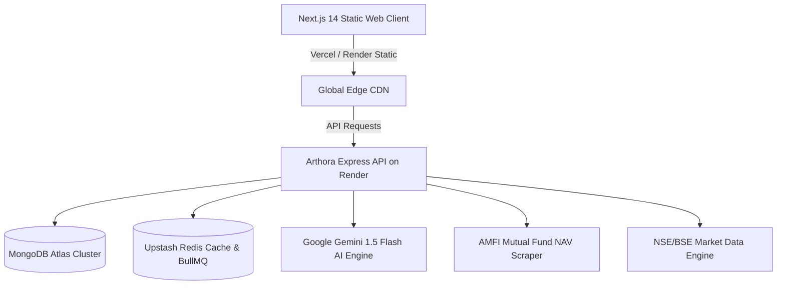

# Arthora Deployment & Infrastructure Architecture

## Architecture Overview



---

## 1. Vercel Frontend Deployment

### Monorepo Settings
When importing `syedzahidsaleem/arthora` into Vercel:

| Setting | Value | Rationale |
| :--- | :--- | :--- |
| **Framework Preset** | `Other` (or auto-detected via root `vercel.json`) | Web uses Next.js static export (`output: 'export'`) |
| **Root Directory** | `.` (Repository root) | Ensures access to `pnpm-workspace.yaml` and `@arthora/shared` |
| **Build Command** | `pnpm --filter @arthora/shared build && pnpm --filter @arthora/web build` | Pre-compiles TypeScript shared types before Next.js export |
| **Output Directory** | `apps/web/out` | Contains pre-rendered static HTML, CSS, and JS bundles |
| **Install Command** | `pnpm install` | Installs root monorepo workspace dependencies |

### Environment Variables on Vercel
- `NEXT_PUBLIC_API_URL`: `https://arthora-api.onrender.com` (automatically falls back if omitted)
- `NEXT_PUBLIC_FIREBASE_API_KEY`: Firebase web API key
- `NEXT_PUBLIC_FIREBASE_PROJECT_ID`: `arthora-659a8`
- `NEXT_PUBLIC_FIREBASE_AUTH_DOMAIN`: `arthora-659a8.firebaseapp.com`

---

## 2. Render Full-Stack Services (`render.yaml`)

The repository includes a Render Blueprint specification deploying both the Node.js backend and static frontend:

1. **`arthora-api` (Web Service)**:
   - **Environment**: Node.js
   - **Build Command**: `pnpm install && pnpm --filter @arthora/shared build && pnpm --filter @arthora/api build`
   - **Start Command**: `pnpm --filter @arthora/api start`
   - **Health Probe**: `/api/v1/health`

2. **`arthora-web` (Static Site)**:
   - **Environment**: Static
   - **Build Command**: `pnpm install && pnpm --filter @arthora/shared build && pnpm --filter @arthora/web build`
   - **Publish Directory**: `./apps/web/out`
   - **Routes**: SPA rewrite rule `/* -> /index.html`

---

## 3. Local Verification

To run and verify the entire stack locally:

```bash
# 1. Install all dependencies across workspace
pnpm install

# 2. Build shared contracts
pnpm --filter @arthora/shared build

# 3. Start API server (port 4000)
pnpm --filter @arthora/api dev

# 4. Start Next.js client (port 3000)
pnpm --filter @arthora/web dev
```
